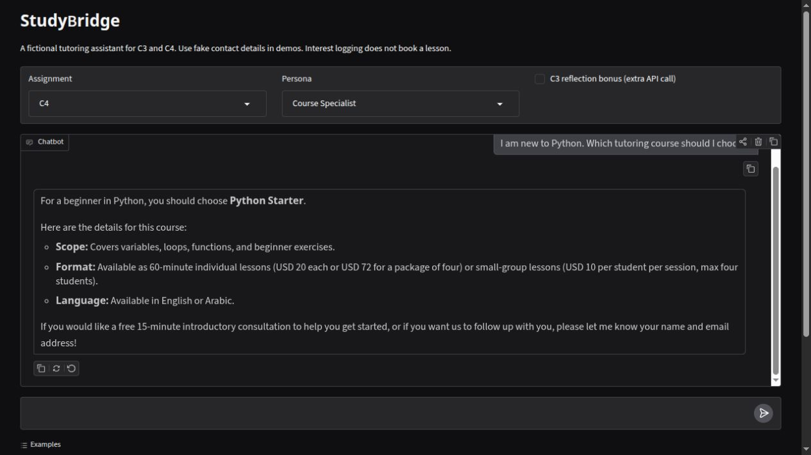

# StudyBridge: C3 and C4 assignments

StudyBridge is a fictional bilingual tutoring business. C3 implements a business
chatbot with a three-way router, separate persona and instructions, PDF/TXT sources,
manual Gemini function calling, short-term history, and Gradio. C4 extends it with
a manually built LangGraph ReAct loop, two configured personas, prompt experiments,
actual result logs, and five completed reflection answers.

[Open C3 in Colab](https://colab.research.google.com/github/ahnaineh/studybridge-assignment/blob/main/business_agent.ipynb) ·
[Open C4 in Colab](https://colab.research.google.com/github/ahnaineh/studybridge-assignment/blob/main/react_agent.ipynb)

## Contents

- `business_agent.ipynb`: C3 explanation and executable implementation.
- `react_agent.ipynb`: C4 implementation, measured comparison and reflection.
- `me/about_business.pdf` and `me/business_summary.txt`: fictional business sources.
- `agent_core.py`: shared prompts, router, validated tools, bounded loops and traces.
- `app.py`: Gradio interface with assignment/persona selection.
- `experiments.py`: reproducible live comparison runner.
- `evidence/`: real Colab outputs, original experiment files and reviewed scores.
- `reflection.md`, `VALIDATION.md`, `demo_script.md`: reflection, verification and video guide.

[](media/studybridge_demo.mp4)

[Watch/download the silent demo video](media/studybridge_demo.mp4) ·
[Submission guide](SUBMISSION.md) · [Moodle link file](submission_link.txt)

The video shows actual C3 price, lead, memory, unknown-policy and feedback flows,
then a C4 course recommendation. Typing speed varies and idle API waits are shortened.
Optional Hugging Face hosting and C3 draft/revision reflection bonus evidence are
not claimed as completed.

## Run in Colab

Open either notebook above and run its setup, installation and key cells. Setup
fetches this public repository when project files are absent. Add a Colab Secret
named `GEMINI_API_KEY`, or enter the key through the hidden prompt. Never save it
in a notebook cell or output. The default model is `gemini-3.5-flash-lite`.

Implementation and saved-result cells run without making new model requests.
Set `RUN_LIVE_DEMO=True` to repeat live conversations, `START_DEMO=True` to launch
Gradio, or `RERUN_EXPERIMENTS=True` in C4 to repeat the full study. The Colab UI uses
a private authenticated proxy with `share=False`. Clear chat before changing a
persona for comparison. Use synthetic contacts such as alex@example.com.

## Run locally

Python 3.11 or newer:

```bash
python -m venv .venv
source .venv/bin/activate
pip install -r requirements.txt
cp .env.example .env
# Add your key privately to .env.
python app.py
```

Calls are paced at least 13 seconds apart in the example configuration. Adjust
`STUDYBRIDGE_MIN_REQUEST_INTERVAL` for your account quota. A conversation has at
most six model steps; each step allows up to three attempts for 503/504 errors.
429 quota errors are surfaced without automatic retries. A generation retry does
not rerun tools already executed. Identical actions are cached within a turn,
but separate user requests can create duplicate records.

## Tools and memory

`record_customer_interest(email, name, message)` appends a lead to JSONL.
`record_feedback(question)` appends feedback or an unknown business question.
`lookup_courses(query)` reads the published catalog. Every native tool call receives
an observation, and automatic SDK execution is disabled. Before a lead is saved,
its name and email must appear in actual student messages, rather than only in a
prompt example. Email-shape and required-field validation also apply.

History includes the last 12 user/assistant messages. Logs record actions separately;
they are not a persistent conversation database. This prototype records interest,
not bookings or payments. It cannot invent refund policies or available slots.

## C4 evaluation

Friendly Advisor uses temperature 0.7, top-p 0.95, top-k 40. Course Specialist uses
0.2, 0.8 and 20. Both allow 2048 output tokens. Persona comparisons therefore test
the complete configuration, not temperature in isolation.

The primary study contains 60 conversations: two personas × four prompt setups ×
seven cases, plus two instruction-ablation cases per persona. The setups are a
system baseline with one worked example, zero-shot, a planning cue, and in-message
placement. A focused extension tests two-example few-shot and explicit internal
stepwise reasoning. Provider thinking settings are unchanged; no private reasoning
is logged. The full current runner covers 68 conversations:

```bash
python experiments.py --smoke
python experiments.py --repeats 1
python -m unittest discover -s tests -v
```

The two runs contain 68 attempts, 25 returned answers and 43 provider failures.
See `evidence/c4/EXPERIMENT_REPORT.md` for results and limits. Original provider
errors remain visible. Quality scores were assigned by the assisting coding agent
from the returned answer and action trace; they are qualitative and not independent
human evaluation. No quality score is assigned to provider-error rows.

| Criterion | 0 | 1 | 2 |
|---|---|---|---|
| Grounded | Unsupported/wrong facts | Mostly correct or incomplete | Accurate; unknowns explicit |
| Helpful | Fails request or harmful action | Partly useful | Complete answer or useful next step |
| Natural | Inappropriate/awkward | Acceptable | Clear and fits the persona |
| Instructions | Important violation | Minor omission | Respects rules and tool outcomes |

The automated tool check only verifies expected successful tool names and forbidden
calls. It does not establish factual accuracy or correct arguments. Original
synthetic logs are included only in curated evidence; ordinary `logs/` and `results/`
are ignored to avoid accidental publication of real contacts.

## Submission

Submit `submission_link.txt` separately through the C3 and C4 Moodle assignment
pages. It links to this repository, each notebook, the included video, and the C4
report/reflection. See [SUBMISSION.md](SUBMISSION.md) for the handoff. Both notebooks
include the required implementation directly.
The business summary filename follows the C3 checklist's `business_summary.txt`.

## References

- [Google Gen AI Python SDK](https://github.com/googleapis/python-genai)
- [Gemini function calling](https://ai.google.dev/gemini-api/docs/function-calling)
- [LangGraph workflows](https://docs.langchain.com/oss/python/langgraph/workflows-agents)
- [Gradio ChatInterface](https://www.gradio.app/docs/gradio/chatinterface)

The implementation uses the maintained Google Gen AI SDK rather than the older
Gemini import shown in the brief. The tool schemas use explicit descriptions and
JSON schemas; they execute locally and do not require an MCP server.
